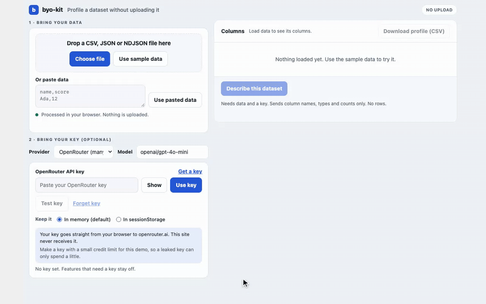

# byo-kit

**Add "bring your own data" and "bring your own key" to a static demo. Data is processed in the browser. Keys are never stored.**



Most demos either ship canned data or ask visitors to trust a server with their files and their API keys. byo-kit gives you two Web Components that do the honest version, plus a tiny relay for providers that browsers cannot call directly. No dependencies, no build step.

```html
<script type="module" src="/vendor/byo-kit.js"></script>

<byo-data sample-url="sample.csv"></byo-data>
<byo-key provider="anthropic"></byo-key>

<script type="module">
  const data = document.querySelector('byo-data');
  data.validate = (rows) => (Array.isArray(rows) && rows.length ? [] : ['Expected a list of rows.']);
  data.addEventListener('byo-data', (e) => {
    const { data, name, source, bytes } = e.detail; // source: 'sample' | 'file' | 'paste'
  });
</script>
```

`dist/byo-kit.js` is the whole library in one file. Copy it into your project. To see it work, run `node tools/static-server.mjs . 8787` and open `http://127.0.0.1:8787/example/`.

## What you get

| Piece | What it does |
| --- | --- |
| `<byo-data>` | Drop zone, file picker, paste box and a "Use sample data" button. Reads JSON, NDJSON and CSV (RFC 4180: quotes, escaped quotes, CRLF, byte order mark). Size limit, your `validate()` errors shown inline, one `byo-data` event. |
| `<byo-key>` | Masked key field with show and hide, memory or sessionStorage, "Forget key", an optional `test()` hook, and a plain statement of where the key goes. |
| `countNetworkCalls(fn)` | Counts `fetch`, XHR and beacon calls made while `fn` runs, so the page can say "0 network requests while processing" and mean it. |
| `createRelay({routes, allowedOrigins})` | A stateless pass through for Cloudflare Workers, for providers that send no CORS headers. |
| `toCsv()` | CSV export that neutralizes spreadsheet formula injection. |
| `tools/record-demo.mjs` | Records a README GIF of at most 10 seconds from a JSON step script. |
| `templates/` | README, `wrangler.jsonc`, `worker.js`, and Depot CI files for the next project. |

## Bring your own data

`<byo-data>` attributes: `sample-url`, `max-bytes` (default 5 MiB). Properties: `validate(data) -> string[]`, `value`, `load(text, {name, source})`, `clear()`.

The event detail is `{ data, name, source, bytes }`. CSV arrives as an array of objects keyed by the header row. The element dispatches the event inside the network counter, so the line under the box ("Loaded sample.csv: 120 records, 7.1 KB. 0 network requests while processing.") covers reading, your `validate()` and the synchronous part of your listeners. Work you start later, such as an awaited fetch, is outside the window.

The element also fires `byo-data-error` with `{ errors }`.

## Bring your own key

`<byo-key provider="openai | anthropic | typesafe">` or set `el.provider` to your own descriptor:

```js
el.provider = {
  id: 'acme', label: 'Acme', keyPattern: '^acme_[a-z0-9]{24,}$',
  docsUrl: 'https://acme.example/keys',
  mode: 'direct',                      // or 'relay' with relayPath: '/api/acme'
  endpoint: 'https://api.acme.example',
  auth: { header: 'authorization', prefix: 'Bearer ' },
  headers: {},                         // fixed extra headers
};
el.test = async (key) => ({ ok: true, message: 'Acme accepted the key.' }); // optional
const key = el.getKey();               // string or null
el.addEventListener('byo-key', (e) => e.detail); // { provider, state, hasKey, storage, ok?, message? }
```

The event never carries the key. Call `getKey()` when you need it. `requestFor(provider, key, path, origin)` returns the URL and headers for a call, and `createKeyTest(provider)` builds a cheap `GET` test.

| Provider | Mode | Notes |
| --- | --- | --- |
| `openai` | direct | Bearer key straight to `api.openai.com`. |
| `anthropic` | direct | Sends `anthropic-dangerous-direct-browser-access: true`. Anthropic requires it for browser calls. The name is a warning: the page can see the key, so use one you can revoke. |
| `typesafe` | relay | `api.typesafe.ai` sends no `Access-Control-Allow-Origin` header (checked), so a browser cannot call it. Calls go through your relay at `/api/typesafe`. |

Where the key lives: in memory by default, or in `sessionStorage` if the visitor picks it. Nothing else touches storage, and a test fails the build if the shipped code names `localStorage`, IndexedDB or cookies.

### The relay

```js
import { createRelay } from './relay/index.js';

const relay = createRelay({
  allowedOrigins: [],                    // empty means same origin only
  routes: {
    '/api/typesafe': {
      upstream: 'https://api.typesafe.ai',
      methods: ['GET', 'POST'],
      allowPaths: ['/v1/'],
      headers: [],                       // extras beyond authorization and content-type
      maxBodyBytes: 200_000,
      timeoutMs: 30_000,
    },
  },
});
// in your Worker: if (relay.matches(request)) return relay(request);
```

It forwards only the headers you list, drops cookies both ways, never logs headers or bodies, refuses other browser origins, answers `OPTIONS`, passes the upstream status and body through, refuses upstream redirects, and times out. It cannot stop clients other than browsers, since they can leave out the `Origin` header. Put only routes on it that you are happy to forward.

## Theme it

Everything is a CSS custom property or a part:

```css
byo-data, byo-key { --byo-accent: #0a7d5a; --byo-radius: 8px; }
byo-data::part(dropzone) { border-style: solid; }
```

Variables: `--byo-bg --byo-soft --byo-ink --byo-muted --byo-line --byo-accent --byo-accent-soft --byo-on-accent --byo-good --byo-warn --byo-danger --byo-radius --byo-font --byo-mono`. Parts: `box dropzone button primary input textarea label link privacy status errors route choice`. Light and dark follow `prefers-color-scheme`. Controls are real buttons and inputs with labels and visible focus, and motion stops under `prefers-reduced-motion`.

## Make the README GIF

```sh
NODE_PATH=/path/to/node_modules node tools/record-demo.mjs --serve . --steps docs/demo-steps.json --out docs/demo.gif
```

Steps are `goto`, `click`, `hover`, `type`, `fill`, `upload` and `wait` (see `docs/demo-steps.json` and the header of the tool). It draws a visible cursor with press feedback, records 1280x800 in Chrome, converts with ffmpeg `palettegen` and `paletteuse`, prints the duration and size, saves the final frame as a PNG, and refuses to write a GIF longer than 10 seconds. Playwright, Chrome and ffmpeg are found on your machine; none of them is a dependency.

## Security notes

- Keys: memory or `sessionStorage` only. Never `console`, never the URL, never in event details. The example also removes the key from provider error messages before showing them.
- User data reaches the page through `textContent` only. The code has no `innerHTML`, and a test enforces it.
- `toCsv()` prefixes cells that start with `=`, `+`, `-`, `@`, tab or carriage return with an apostrophe. Plain numbers stay numbers.

## Status and honest limits

- Tested: unit tests for the parser, exporter, network counter, providers, key store, relay and templates (`node --test`), and a headless Chrome run of the example with a sample file, pasted CSV and JSON, an uploaded NDJSON file, key storage choices, and a stubbed Anthropic endpoint that checks the key, the browser header and that no row values leave the page.
- Not tested: a call to a live provider. The OpenAI and Anthropic request shapes follow their public docs, and default model names (`claude-haiku-4-5`, `gpt-4o-mini`) may need editing. The `typesafe` relay path has not run against the live API with a real key.
- Nothing is published or deployed from this repo yet. The Worker templates have not been run under `wrangler`.
- The network counter sees `fetch`, XHR and `sendBeacon` only. It does not see image or script loads, WebSockets, or calls made later by code you start.
- Browsers: checked in Chrome. Web Components and constructed stylesheets are in all current browsers, but others were not tried.
- The example GIF shows a key being entered, not a model call, because a call would need a real key.

## Development

```sh
node --test              # unit tests
node scripts/bundle.mjs  # rebuild dist/byo-kit.js (CI checks it is current)
script/cibuild           # the CI gate; add NODE_PATH to include the browser smoke
```

Source is plain ES modules in `src/`. Logic with no DOM lives in `src/core/` so it runs under `node --test`. Needs Node 20 or later.

MIT licensed. Copyright 2026 Dallas Crilley.
